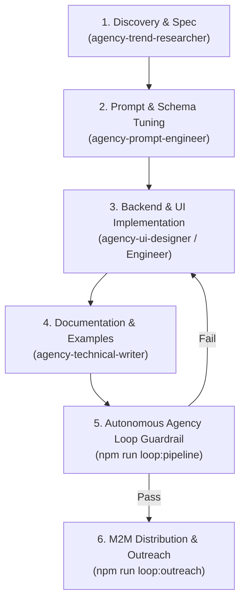

# Autonomous Agency Pipeline & Execution Loop Specification

**Purpose:** Autonomous development, design, and verification protocol for the `AIPages` registry and `AUS Fleet`.  
**Coordinating Role:** `agency-agents-orchestrator`  
**Execution CLI:** `npm run loop:verify` | `npm run loop:sync` | `npm run loop:pipeline`

---

## 1. Pipeline Overview & Swarm Roles

Whenever new tools are added or frontend templates are updated, the agency agents operate in a continuous, deterministic loop:



| Agent Specialist | Loop Responsibility | Output Deliverables |
|---|---|---|
| **`agency-agents-orchestrator`** | Pipeline conductor, enforces quality gates and prevents progression on failure | Phase advancement, execution of `npm run loop:*` |
| **`agency-trend-researcher`** | Scans market gaps, trending GitHub MCP repos, and user demand | Tool specification briefs, target repo candidates |
| **`agency-prompt-engineer`** | Tunes tool descriptions, schema parameter hints, and capability tags for LLM ranking | Optimized schemas in `src/data/ausTools.ts` |
| **`agency-ui-designer`** | Enhances UI/UX, responsive cards, theme contrast, and navigation | HTML/CSS templates in `src/views/` |
| **`agency-technical-writer`** | Crafts copyable curl/SDK integration snippets, README docs, and PR outreach text | Integration tabs in `src/views/toolPage.ts`, docs in `README.md` |
| **`agency-payments-billing-engineer`** | Audits x402 Base payment settlement, gas routing, and pricing models | Middleware config in `src/middleware/x402.ts` |

---

## 2. Standard Operating Procedure: Adding New Tools

Follow this exact sequence when adding a tool to the AUS fleet:

### Step 1: Backend Service Implementation
Create a standalone, strongly-typed service module under `src/services/<serviceName>.ts`:
```typescript
export interface ToolRequest { ... }
export interface ToolResult { ... }
export function executeTool(req: ToolRequest): ToolResult { ... }
```
Export it from `src/services/index.ts`.

### Step 2: Fleet Registration in `src/data/ausTools.ts`
Append the canonical tool record conforming to first-party standards:
- **Namespace:** `net.2xcel.aus.<kebab-name>`
- **Name:** snake_case identifier matching schema
- **Endpoint:** `https://aipages.tech/tool/<kebab-name>`
- **Health Status:** Strictly `"unknown"` (resolves to `"unchecked"` per Anti-Falsification Rule)
- **Pricing:** Valid `paid` or `free` model in USDC on Base
- **Authentication:** `AUS_AUTH_SPEC` (x402 receipt header)
- **Capabilities:** Non-empty array of lowercase alphanumeric tags

### Step 3: Capability Indexing in `src/views/capabilitiesPage.ts`
For every capability tag defined in Step 2:
- Ensure an entry exists in `CAPABILITY_DESCRIPTIONS[tag]` with an informative, human-readable summary.

### Step 4: Verification & Automated Pipeline
Run the unified agency pipeline:
```bash
npm run loop:sync
```
This automatically executes:
1. Catalog validation assertion (`assertValidFirstPartyTools`).
2. Capability description completeness check.
3. Tool store seeding (`scripts/seed.ts`).
4. Production TypeScript compilation into `dist/`.

---

## 3. Standard Operating Procedure: Updating Website Appearance

Follow this sequence when redesigning or styling the website:

### Design & Architecture Rules:
1. **Zero Raw Emojis:** Per UI/UX Pro Max rules, never use emoji characters as UI buttons, status indicators, or navigation marks. Use semantic SVG icons or badges (`badge-free`, `badge-paid`, etc.).
2. **Accessible Contrast:** Maintain WCAG AA 4.5:1 minimum contrast on all text elements across light (`#FFFFFF`) and dark canvas (`#0F172A`).
3. **No Dead Links:** Every tool link must use `/tool/:slug` or `/tools/:slug`.
4. **Responsive Breakpoints:** Test views across mobile (375px), tablet (768px), and desktop (1280px+).

### Quality Verification:
```bash
npm run loop:verify
npm test
npm run build
```

---

## 4. Standard Operating Procedure: Autonomous Distribution & Outreach

To continuously promote AIPages to other agent builders:

1. Ensure `GITHUB_TOKEN` is set in `.env`.
2. Run the outreach worker:
   ```bash
   npm run loop:outreach
   ```
3. The engine automatically:
   - Scans GitHub for actively updated repositories containing `mcp.json`.
   - Generates personalized integration snippets with attribution tracking (`promotedBy: aus-agent-alpha`).
   - Dispatches non-spammy collaboration issues with drop-in configuration blocks.
   - Logs verified tools to the registry.

---

## 5. Command Reference

| Command | Action | Used By |
|---|---|---|
| `npm run loop:verify` | Validates catalog, capability tags, and service file health | All Agents (Pre-flight check) |
| `npm run loop:sync` | Validates, seeds the database, and recompiles `dist/` | `agency-agents-orchestrator` |
| `npm run loop:pipeline` | Complete full verification, seed, build, and test suite | CI/CD & Production Deployment |
| `npm run loop:outreach` | Executes discovery, health checks, and promotional snippet generation | 24/7 Background Cron |
